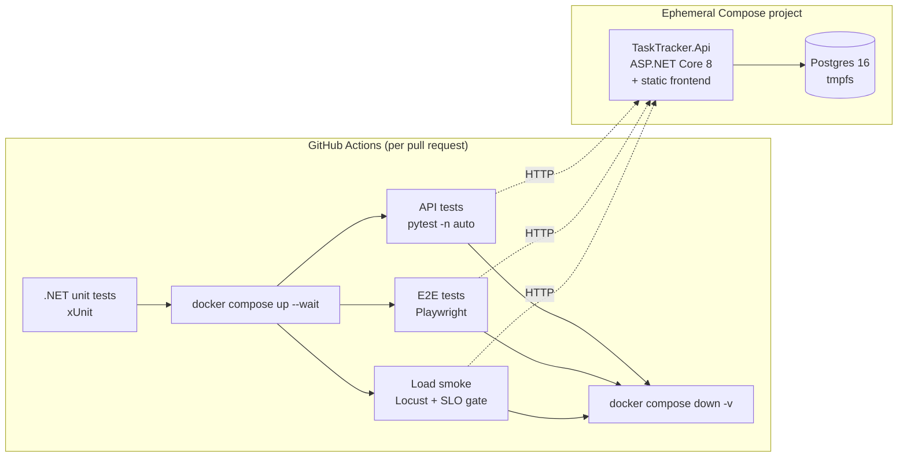

# Cross-stack quality pipeline

An ASP.NET Core API tested by a separate Python QA suite: functional API tests (pytest + requests),
browser end-to-end tests (Playwright) and load tests (Locust). On every pull request, GitHub Actions starts a
fresh API and Postgres with Docker Compose, runs every suite against them, and tears the environment down.

The split mirrors a common setup: the service team ships .NET, while the QA team owns a Python suite that
treats the service as a black box over HTTP.



## Repository layout

```
api/
  TaskTracker.Api/          ASP.NET Core 8 minimal API, EF Core + Npgsql, JWT auth
    wwwroot/                Small vanilla-JS frontend served by the API (target of the E2E tests)
  TaskTracker.UnitTests/    xUnit tests for pure domain logic (workflow rules, validation)
  Dockerfile
qa/
  framework/                Reusable API test framework
    session.py              requests.Session wrapper: base URL, timeouts, auth, redacted traffic log
    clients.py              Resource clients (auth, projects, tasks) returning raw responses
    schemas.py              Pydantic response contracts (extra="forbid" catches contract drift)
    factories.py            Test data builders stamped with a per-run id
    steps.py                Happy-path arrange helpers shared by API and UI tests
    assertions.py           Status and RFC 7807 problem-details assertions
  tests/api/                Functional API tests
  tests/e2e/                Playwright tests + page objects
  load/locustfile.py        Load profile with SLO thresholds
docker-compose.yml          API + throwaway Postgres
.github/workflows/ci.yml    PR pipeline
```

## The API

A task tracker. Users own projects and projects contain tasks.

| Endpoint | Notes |
|---|---|
| `POST /api/auth/register`, `POST /api/auth/login` | PBKDF2 password hashing, HS256 JWT |
| `GET/DELETE /api/auth/me` | Deleting the account cascades to all of the user's data |
| `GET/POST /api/projects`, `GET/PUT/DELETE /api/projects/{id}` | Paged list with task counts; names unique per owner |
| `GET/POST /api/projects/{id}/tasks` | Filter by `status`, `priority`, `search` (case-insensitive, wildcards literal) |
| `GET/PATCH/DELETE /api/tasks/{id}` | PATCH updates only the fields sent |
| `POST /api/tasks/{id}/status` | Enforces the workflow; illegal moves return 409 with the allowed statuses |
| `GET /health` | Checks the database connection; used by the Compose healthcheck |

All errors are RFC 7807 problem details. Another user's resources return 404, never 403, so ids can't be probed.
Swagger UI is at `/swagger`.

## Running it locally

Prerequisites: Docker and Python 3.11+. The .NET SDK is optional, because everything .NET builds inside Docker.

```bash
docker compose up --build --detach --wait
```

```bash
cd qa
python -m venv .venv && . .venv/bin/activate   # Windows: .venv\Scripts\activate
pip install -r requirements.txt
python -m playwright install chromium
```

```bash
pytest tests/api -n auto
```

```bash
pytest tests/e2e --headed          # add --browser-channel msedge to use the system Edge
```

```bash
locust -f load/locustfile.py --host http://localhost:8080 --headless -u 50 -r 10 -t 90s
```

```bash
docker run --rm -v "$PWD/api:/src" -w /src mcr.microsoft.com/dotnet/sdk:8.0 dotnet test TaskTracker.UnitTests
```

```bash
docker compose down -v
```

The app itself is at http://localhost:8080. Set `API_PORT` to run a second stack beside the first.

## Test strategy: what gets tested where

The rule: **test each behaviour at the lowest level that can actually observe it**, and only move up a level for
what the level below cannot see.

| Level | Tool | Owns | Example |
|---|---|---|---|
| Unit | xUnit | Pure rules with many combinations: cheap, fast, exhaustive | All 16 status transitions; validation boundaries (100 vs 101 chars, due date today vs yesterday) |
| API | pytest + requests | Anything that needs HTTP, the database or auth: contracts, persistence, authorization, concurrency, error shapes | Illegal transition returns 409 *and* leaves state unchanged; user B gets 404 for user A's task; 8 racing duplicate creates give exactly one 201 and no 500s |
| UI | Playwright | Whether a user can complete the critical journeys, and whether the frontend renders what the API returns | Register, sign in/out, create project, add task, complete it, counts update |

Examples of that rule in practice:

- The workflow matrix is tested only in xUnit. The API suite checks one legal lifecycle and one illegal move,
  because what it adds is the HTTP contract (status code, `allowedStatuses`, no state change), not more rule coverage.
- UI tests arrange their data through the API (`framework/steps.py`) and test only the interaction itself. Only
  the login tests use the login form; every other UI test starts signed in by seeding the token
  (`signed_in_page`). That keeps them fast and stops one broken screen from failing every UI test.
- UI tests that change data also confirm it through the API. The UI saying "Done" isn't enough.
- Response bodies are validated against Pydantic models with `extra="forbid"`. A renamed or new field in the .NET
  DTOs fails the suite instead of being silently ignored.

## Keeping test data isolated between parallel runs

Several layers, each covering a different kind of collision:

1. **Per-run environment.** Each CI run gets its own Compose project (`COMPOSE_PROJECT_NAME=tt-<run>-<attempt>`), with its
   own containers, network and a tmpfs-backed database that disappears on teardown. No state survives between runs.
2. **Per-test identity.** Every test registers its own user (`account_factory`). All data is owner-scoped in the
   API, so tests running in parallel on the same database (`pytest -n auto`) can't see each other's data, and
   assertions like `total == 5` stay exact.
3. **Unique values.** Anything with a uniqueness constraint (emails, project names) gets a value from
   `factories.unique()`, which embeds `RUN_ID` + the xdist worker id + a random suffix.
4. **Cleanup by cascade.** Teardown deletes each test account, and the database cascades to its projects and tasks.
   That keeps a long-lived shared environment, such as staging, clean too.
5. **Load tests follow the same model.** Each Locust user registers and seeds its own account, and deletes it on stop.

Nothing depends on test order or on pre-seeded fixtures, so any subset of tests can run in any order or in parallel.

## Load testing: finding and fixing a bottleneck

Profile: 50 concurrent users, spawn rate 10/s, 90 s. Each user owns 20 projects with 3 tasks each. The weighted mix
is dashboard 6 : open project 3 : add task 2 : start task 1.

The first run showed `GET /api/projects` (the dashboard) at **5× the latency** of the task list, even though both
read similar amounts of data. Turning on Postgres statement logging for a single request showed the cause: an
**N+1 query**. The handler loaded a page of projects and then ran two `COUNT` queries per project, which comes to
**42 SQL statements** for a 20-row page.

The fix (`ProjectEndpoints.List`) projects the counts in the same query. EF Core translates that into **one statement**
with correlated subqueries, served by the existing `(ProjectId, Status)` index. That makes **2 statements** in total,
including the paging count.

| `GET /api/projects` @ 50 users | Median | p95 | p99 | Failures |
|---|---:|---:|---:|---:|
| Before (N+1) | 36 ms | 66 ms | 130 ms | 0 |
| After (single projection) | 7 ms | 16 ms | 44 ms | 0 |

After the fix, the regression suite (55 API tests, 8 E2E tests) still passes, and the endpoint performs like the
task list (7 ms / 15 ms).

**Measurement caveat.** On Windows with Docker Desktop, every request *with a body* showed a flat ~45 ms extra.
Requests sent from inside the container took ~4.5 ms, so the delay is added by Docker Desktop's host-to-VM port
forwarding, not by the API. The GitHub Actions Linux runner, which has no such forwarding layer, confirmed this:

| Write endpoint (median / p95) | Windows host, Docker Desktop (50 users) | Linux CI runner (25 users) |
|---|---:|---:|
| `POST /api/projects/{id}/tasks` | 49 / 56 ms | 4 / 9 ms |
| `POST /api/tasks/{id}/status` | 50 / 58 ms | 4 / 13 ms |

The two profiles differ in user count, but halving the load can't explain a 10× gap, and the in-container
measurement gives the same ~4 ms. Write latencies measured from a Windows host are not representative. The
`GET /api/projects` before/after comparison above is still valid, because GET requests have no body and
don't pay this overhead.

In CI, a shorter smoke profile (25 users, 60 s) runs as a gate: the job fails if any key endpoint's p95 exceeds
500 ms or more than 1% of requests fail. A results table is posted to the job summary.

## CI pipeline

`.github/workflows/ci.yml` runs on every pull request and on pushes to `main`:

1. **unit**: `dotnet test` on the domain tests (fails fast before any containers start).
2. **integration**: `docker compose up --build --wait` (blocks until both healthchecks pass), then the API
   tests in parallel, the E2E tests (traces and screenshots kept on failure), and the load smoke test with its SLO gate.
   Later suites still run if an earlier one fails, so one run reports everything. Service logs are captured on
   failure, all reports are uploaded as artifacts, and `docker compose down -v` always runs.

## Known limitations

- JWTs are stateless, so a token stays valid until it expires (60 min) even after its account is deleted.
  Only `/me` checks that the user still exists.
- The schema is created with `EnsureCreated()`, which suits ephemeral environments. A long-lived deployment
  would use EF Core migrations.
- For load numbers on Windows that are free of the forwarding overhead above, run Locust inside the Compose
  network instead of on the host.
